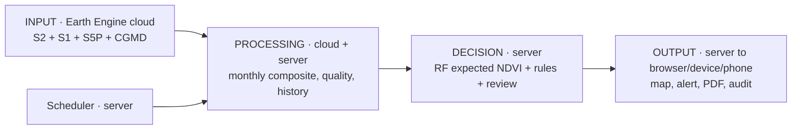

# Mangrove Lens: content for exactly 11 review slides

**Use as text in your own template. Do not claim a live service is currently running merely because a previous run succeeded.** Status and numbers are from repository inspection on 12 Nov 2026 and recorded Earth Engine verification on 4 Nov 2026. `Implemented` means code exists; `validated` means evidence was actually measured. The project paper [`Mangrove_Guardian_Research_Paper_final.pdf`](../../Mangrove_Guardian_Research_Paper_final.pdf) is a plan, not proof of delivered features.

## Slide 1 — Problem & solution story

**Main message:** The Sundarbans need trustworthy, reviewable condition evidence between periodic inventories; Mangrove Lens is a prototype workflow for that need.

**Exact slide copy:**
> **Sundarbans: observe change, then verify it.**  
> India's 2023 mangrove cover: **4,991.68 km²**; West Bengal: **2,119.16 km²**.  
> Existing platforms already map extent and loss; local teams still need a practical way to triage *condition* changes and explain the evidence.  
> **Mangrove Lens:** monthly satellite observations → NDVI deviation → human-review alert → sourced report.  
> **Current boundary:** an anomaly is a lead for investigation, not confirmed degradation.

**Layout/hierarchy:** left: Sundarbans map/geography; center: problem and affected forest/restoration analysts; right: four-step solution. Largest typography on “observe change, then verify it.”

**Visuals:** Original source-linked Sundarbans map or a time-stamped own Earth Engine screenshot; small FSI West Bengal share bar (2,119.16/4,991.68 = **42.45%** of India's mapped cover, not the share of the whole transboundary Sundarbans).

**Sources:** FSI, *ISFR 2023*, 2023, [report](https://fsi.nic.in/uploads/isfr2023/isfr_book_eng-vol-1_2023.pdf); UNESCO, *The Sundarbans*, 19 Jul 2024, [article](https://www.unesco.org/en/articles/sundarbans?hub=70318); Global Mangrove Alliance, *GMW 4.1 Launch*, 27 Jul 2026, [source](https://www.mangrovealliance.org/news/global-mangrove-watch-4-launch); local [live run](../../reports/LIVE_SYSTEM_EVIDENCE_2026-11-04.md).

**Say aloud:** “We are adding a review workflow around satellite condition, not claiming that no one maps mangroves. The output is a screening lead that an expert can accept or reject.”

## Slide 2 — Technical approach

**Main message:** The prototype is a real Earth Engine to dashboard pipeline, with clear scientific limits.

**Exact slide copy:**
> **Implemented:** React/Vite browser UI; Python/FastAPI API; PostgreSQL; Earth Engine `nex-sync`; scikit-learn Random Forest; Docker Compose scheduler.  
> **Inputs:** Sentinel-2 SR (NDVI/NDMI), Sentinel-1 GRD (VV/VH), Sentinel-5P OFFL CO (context), 2023 CGMD mangrove mask.  
> **Processing:** SCL cloud mask, monthly composites, AOI mean at 100 m, quality gate, lagged features, rule-based review alert.  
> **Proposed:** tide/orbit harmonization, per-cell inference, independent labels, GMW benchmark and field validation.  
> **Data cadence:** completed monthly windows; UI refreshes about every 15 seconds.

**Layout/hierarchy:** 2-column “implemented / next evidence gates,” with input badges above a compact pipeline. Avoid a “real-time satellite stream” label.

**Visuals:** source-stack icons or an original data lineage diagram; no invented model-accuracy badge.

**Sources:** local [provider](../../src/providers/earth_engine.py), [training](../../scripts/train_model.py), [scheduler](../../scripts/run_scheduler.py), [dashboard](../../frontend/src/pages/Dashboard.jsx); Google Earth Engine [S2 catalog](https://developers.google.com/earth-engine/datasets/catalog/COPERNICUS_S2_SR_HARMONIZED), [S1 catalog](https://developers.google.com/earth-engine/datasets/catalog/COPERNICUS_S1_GRD), [S5P CO catalog](https://developers.google.com/earth-engine/datasets/catalog/COPERNICUS_S5P_OFFL_L3_CO) (Google; dates not stated).

**Say aloud:** “The EO computation runs in Google’s cloud; the API stores a monthly summary and model decision. Sentinel-5P CO is context, never evidence that a local source damaged a mangrove.”

## Slide 3 — Block diagram: input → processing → decision → output

**Main message:** Every stage has a location, recorded artifact and review boundary.

**Exact slide copy:**
> **INPUT [cloud]:** S2/S1/S5P + CGMD mask → Earth Engine.  
> **PROCESSING [cloud + server]:** monthly composite and AOI reduction → quality check → PostgreSQL history → eight lagged features.  
> **DECISION [server]:** Random Forest expected NDVI → deviation/rules → review flag.  
> **OUTPUT [server → device/phone browser]:** map, timeline, alert queue, PDF report, audit log.  
> **AUTOMATION [server]:** monthly scheduler and post-run retraining; external email requires configuration/approval.  
> **Phone:** browser only; **no on-device ML**.

**Layout/hierarchy:** four horizontal stages with small execution-location labels and one feedback loop from scheduler to processing.

**Visuals:** Create an original four-box diagram or use this textual Mermaid representation in supporting notes:

**Sources:** local [provider](../../src/providers/earth_engine.py), [monitoring workflow](../../src/services/monitoring.py), [scheduler](../../scripts/run_scheduler.py), [notifications](../../src/services/notifications.py).

**Say aloud:** “Our agents are deterministic stages coordinated by a scheduler, not generative AI agents. The system can run without the log viewer or browser open.”

## Slide 4 — AI/ML model (reference image 1)

**Main message:** A measured AOI NDVI forecast baseline exists; there is no validated mangrove-loss classifier.

**Exact slide copy:**
> **Data:** 94 monthly Earth Engine AOI observations (Jan 2019–Oct 2026); 90 valid, four low coverage.  
> **Model:** scikit-learn Random Forest regression, 400 trees, eight prior-month/season features; runs on the server.  
> **Validation:** 66 training rows + last 12 complete months held out; MAE **0.0306 NDVI**, RMSE **0.0413**, R² **0.488**; persistence MAE **0.0484**.  
> **Real example:** Oct 2026 actual NDVI **0.69345** versus expected **0.68957** → low review risk.  
> **Limit:** these are forecast metrics, **not loss-detection accuracy or field precision**.

**Layout/hierarchy:** follow the supplied five-bullet model card: dataset/source, split, error, one input→output, where it runs. Put the limit in a bold bottom strip.

**Visuals:** original plot of actual vs expected over the 12 held-out months only if values can be extracted exactly; otherwise a single Oct 2026 actual/expected bar plus source timestamp. No fabricated curve.

**Sources:** local [dataset validation](../../reports/dataset_validation.json), [evaluation](../../reports/model_evaluation.json), [training code](../../scripts/train_model.py), [live Oct run](../../reports/LIVE_SYSTEM_EVIDENCE_2026-11-04.md). Note Oct example came from the recorded 3 Nov model, while the current manifest is a later 4 Nov training artifact.

**Say aloud:** “We predict the NDVI expected for this month from prior observations, then compare it with the observed NDVI. The sample is small and the error metric is not a claim that we can identify loss pixels.”

## Slide 5 — MVP and technology readiness

**Main message:** Integrated software prototype exists; environmental validity and adoption are still open.

**Exact slide copy:**
> **Working:** authenticated Earth Engine ingestion; 94-month store; model inference; dashboard/map; PDF; scheduler; audit trail.  
> **Demonstrated:** fresh Oct 2026 Earth Engine run, 121 S2 and 22 S1 scenes, plus a review-only March alert.  
> **Remaining:** independent field labels, cell-level alerts, tide/orbit controls, operator trial, external delivery approval.  
> **Overall TRL: 4 (conservative).** Integrated prototype; no relevant-environment decision validation yet.

**Layout/hierarchy:** three zones: “works today / evidence / next gates”; TRL 4 badge with a one-line rationale.

**Visuals:** screenshot from own dashboard with timestamp and status; no claim of regulatory or official deployment.

**Sources:** local [run evidence](../../reports/LIVE_SYSTEM_EVIDENCE_2026-11-04.md), [manifest](../../models/ndvi_forecast_rf.manifest.json), [TRL assessment](mvp_and_trl_assessment.md); NASA ESTO, *TRL definitions*, date not stated, [source](https://esto.nasa.gov/trl/).

**Say aloud:** “The engineering demonstration is real, including a fresh satellite query. We assign TRL 4 to the whole conservation decision system because no independent incident or user validation has been done.”

## Slide 6 — User testing & validation (reference image 2)

**Main message:** No external user test has been documented; here is the test we will run.

**Exact slide copy:**
> **WHO WE TESTED WITH:** No external forest/NGO/operator users tested yet.  
> **WHAT WE WILL ASK THEM TO DO:** 3–5 analysts triage one event and one non-event, inspect uncertainty, choose field review, export a briefing; record completion and time.  
> **WHAT THEY SAID:** No authentic quote yet. Record verbatim feedback and what we changed after the test.  
> **Scientific validation (separate):** blind comparison to field/high-resolution reference and GMW alerts; measure precision, recall and false alerts/month.

**Layout/hierarchy:** match supplied three-panel “who / task / what they said.” Mark proposed work clearly. Do not place a fake quote in the third panel.

**Visuals:** small task checklist; no user photo or testimony unless consented and genuine.

**Sources:** local [user-validation audit](user_validation.md); GMW comparator: Global Mangrove Alliance, *GMW 4.1 Launch*, **2026**, [source](https://www.mangrovealliance.org/news/global-mangrove-watch-4-launch).

**Say aloud:** “We have tested code and data flow, not whether a conservation analyst makes better decisions. We are keeping that gap visible.”

## Slide 7 — Competitor analysis (reference image 3)

**Main message:** Existing systems are strong; our unproven niche is an integrated, auditable local condition workflow.

**Exact slide copy:**

| Criterion | Lens prototype | GMW 4.1 | FSI/NCSCM | Blue Carbon Explorer |
|---|---|---|---|---|
| Primary output | Monthly AOI condition/anomaly | Annual extent + monthly loss alerts | Official extent / community atlas | NDVI/restoration exploration |
| Area | Sundarbans | Global | India | Published GEE tool |
| Local audit/report | Implemented in our code | Not benchmarked against Lens | Published official reports | Published methods |
| Verified loss accuracy | **Not measured** | Extent F1 0.9276 globally; local alert test needed | Different mapping target | Different decision target |
| Price / task speed | **Not measured** | Public map | Public report | Research app |

> **Current distinction:** integrated multi-sensor screening + provenance-rich report. **No proven moat or superiority.**

**Layout/hierarchy:** compact comparison table, proof labels in every nontrivial cell; one bottom “comparison we still owe” bar.

**Visuals:** logos only with permission; original comparison chart is safer.

**Sources:** local [comparison](competitor_analysis.md); Global Mangrove Alliance, *GMW 4.1 Launch*, **2026**, [source](https://www.mangrovealliance.org/news/global-mangrove-watch-4-launch); Bunting et al., *GMW v4.1.12 extent dataset*, **2026**, [record](https://zenodo.org/records/21346457); FSI, *ISFR 2023*, [source](https://fsi.nic.in/uploads/isfr2023/isfr_book_eng-vol-1_2023.pdf); NCSCM, *Atlas*, **2024**, [source](https://ncscm.res.in/mza-2/); McNulty et al., *Blue Carbon Explorer*, **2025**, [source](https://www.frontiersin.org/journals/environmental-science/articles/10.3389/fenvs.2025.1641301/full).

**Say aloud:** “GMW already does monthly alerts. Our candidate difference is how a local analyst reviews a condition anomaly and prepares an auditable briefing; we have not shown that this is faster or more accurate.”

**Additional comparator for notes:** Yancho et al.’s *GEEMMM* (16 Nov 2020, [study](https://www.mdpi.com/2072-4292/12/22/3758)) already provides a GEE mangrove classification/change workflow with tide calibration; the [Bangladesh Forest Information System](https://bfis.bforest.gov.bd/bfis/) already supports national forest management. These strengthen the case for interoperability and a measured analyst-workflow benefit.

## Slide 8 — Business Model Canvas (reference image 4)

**Main message:** B2G/B2B institutional pilot is a testable business hypothesis, not a business already won.

**Exact slide copy:**

| Canvas block | Copy |
|---|---|
| Partners | Prospective forest/coastal agency, NCSCM/FSI, Bangladesh counterpart, field NGO |
| Activities | EO ingestion, validation, alert review, reports, support |
| Resources | Earth Engine, Copernicus data, code, labels, domain experts |
| Value | Auditable local condition triage and report |
| Customer relationships | Co-designed pilot, training, support |
| Channels | Direct agency pilot and research partnership |
| Customers | Forest/coastal analysts, restoration programs |
| Costs | Compute/licence, engineering, field verification, support |
| Revenue/sustainability | Proposed agency subscription or funded pilot; **zero current revenue** |

> **Business-model choice:** B2G institutional pilot hypothesis; no signed buyer, price or partner.

**Layout/hierarchy:** supplied nine-box canvas, one short line per box; highlight value, users and payer separately.

**Visuals:** no financial graphic with invented ₹ values.

**Sources:** local [business model](business_model.md); MoEFCC/PIB, *MISHTI progress*, **21 Aug 2025**, [source](https://www.pib.gov.in/PressReleasePage.aspx?PRID=2159295&lang=2&reg=3); Google, *Earth Engine commercial transition*, date not stated, [source](https://developers.google.com/earth-engine/guides/transition_to_commercial).

**Say aloud:** “The buyer, user and payer could differ. We need interviews and a costed paid Earth Engine scenario before putting a subscription price on this.”

## Slide 9 — Market size: TAM / SAM / SOM

**Main message:** We can bound geographic opportunity, but cannot defend a monetary market size yet.

**Exact slide copy:**
> **TAM (opportunity units):** MISHTI activity in **13 Indian states/UTs**; not 13 confirmed buyers.  
> **SAM (initial geography):** West Bengal + Bangladesh Sundarbans institutional segments.  
> **SOM (achieved):** **0 paying customers / 0 signed pilots documented**.  
> **₹ market size:** pending verified agency count × actual annual procurement price.  
> **Next evidence:** 5 buyer interviews, public tender comparables, costed pilot and procurement route.

**Layout/hierarchy:** funnel of geographic/opportunity units, not money; an explicit “₹ not yet estimable” annotation.

**Visuals:** small map marking West Bengal/Bangladesh and a calculation box `N eligible institutions × annual contract value`; leave both inputs unknown until verified.

**Sources:** MoEFCC/PIB, *MISHTI progress*, **21 Aug 2025**, [source](https://www.pib.gov.in/PressReleasePage.aspx?PRID=2159295&lang=2&reg=3); UNESCO, *The Sundarbans*, **2024**, [source](https://www.unesco.org/en/articles/sundarbans?hub=70318); local [market analysis](market_analysis.md).

**Say aloud:** “Area planted is not revenue. We prefer an honest buyer-discovery calculation over a fabricated TAM.”

## Slide 10 — Risks and mitigation (reference image 5)

**Main message:** The largest risk is interpreting a satellite signal as a confirmed conservation incident.

**Exact slide copy:**

| Risk | Why it matters | Mitigation | How we validate |
|---|---|---|---|
| Cloud/tide/season | False anomaly | Quality gate, tide-aware composite, expert review | Precision and false alarms by season |
| AOI averaging | Local loss missed | Per-cell pipeline | Test known local events vs GMW |
| Model drift/small sample | Unstable forecast | Rolling backtests + baseline | Error and calibration by year |
| Earth Engine cost/outage | Missing or expensive service | Paid-plan estimate, retries, freshness alert | 90-day uptime/cost log |
| Adoption/notification | Wrong action or no user | Controlled pilot, external approval gate | Observed user trial and delivery audit |

**Layout/hierarchy:** supplied four-column risk table. Highlight scientific risk first. Put “current external dispatch disabled” in footnote.

**Visuals:** risk severity dots only if labelled qualitative; no invented probabilities.

**Sources:** local [risk register](risk_assessment.md), [dataset](../../reports/dataset_validation.json), [manifest](../../models/ndvi_forecast_rf.manifest.json); *Remote Sensing* mangrove mapping study, **2020**, [source](https://www.mdpi.com/2072-4292/12/22/3758); Google, *commercial transition*, [source](https://developers.google.com/earth-engine/guides/transition_to_commercial).

**Say aloud:** “We have controls against hasty external messaging. The next proof is to learn how often our anomaly corresponds to a real event, including during tides and monsoons.”

## Slide 11 — Impact and SDG mapping

**Main message:** We can measure monitoring outputs today; environmental and social outcomes require later field evidence.

**Exact slide copy:**
> **Today:** 94 historical monthly records, time-stamped EO provenance, review alerts and audit reports.  
> **SDG 14.2:** potential support for coastal ecosystem protection/restoration → measure confirmed incident follow-up.  
> **SDG 15.1:** potential support for forest management → measure verified coverage and decisions.  
> **SDG 13.1:** potential resilience decision support → measure post-event triage time.  
> **SDG 17.16:** prospective India–Bangladesh/research partnerships → measure signed collaborations.  
> **No impact claim yet:** avoided loss, carbon, biodiversity, livelihoods and safety not measured.

**Layout/hierarchy:** “observed system outputs” above “prospective SDG pathways”; one measurable indicator per goal.

**Visuals:** UN SDG icons only under [UN usage rules](https://www.un.org/sustainabledevelopment/news/communications-material/); a small outcomes ladder is an alternative.

**Sources:** local [dataset validation](../../reports/dataset_validation.json), [SDG mapping](sdg_mapping.md); UN DESA, [Goal 14](https://sdgs.un.org/goals/goal14), [Goal 15](https://sdgs.un.org/goals/goal15), [Goal 13](https://sdgs.un.org/goals/goal13), [2030 Agenda](https://sdgs.un.org/2030agenda) (goal pages undated; Agenda 2015).

**Say aloud:** “Our current achievement is making monitoring evidence available and reviewable. Conservation impact would require actions and field outcomes that have not yet been measured.”
